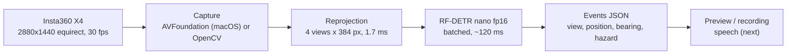
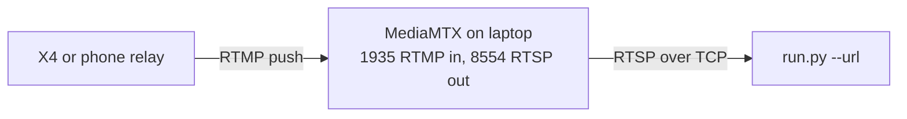

# ShellHacks 360 Vision Handbook

As of 2026-09-26. Everything learned building the Insta360 X4 + RF-DETR prototype, written for the team to build the real assistive app on. A shared copy lives at https://claude.ai/code/artifact/8c21a591-1132-411c-9f3f-bc21e21ad48a

## What this is

The prototype detects objects all around a wearer from an Insta360 X4 on a hat, about 150 ms from motion to box over USB, and the demo will run it from a laptop in a backpack. The code lives in this repo (harness package, `run.py`, `benchmark.py`, scripts, 121 tests at 95% coverage).



Frames flow left to right; the preview runs at camera rate while detection runs in a worker thread on the newest frame.

| Decision | Choice | Why |
| --- | --- | --- |
| Camera link for the demo | USB-C, laptop in a backpack | 150 ms end to end; wireless measured or estimated at 0.5 to 3 s |
| Coverage | 4 perspective views at 90° FOV | Best recall; single-pass panorama kept as the faster fallback |
| Model | RF-DETR nano, float16 | Only size near real time on the M2; larger sizes drop to 7 to 12 FPS |
| Schedule | Async preview | Display 28 FPS with boxes refreshing 8 Hz, versus 5 FPS synchronous |
| Output | One JSON line per detection on stdout | Pipes straight into the speech step |

Proven on 2026-09-26: X4 over USB in both formats, the fake-360 clip and a recorded walk-through, RTSP and RTMP through a local MediaMTX with a simulated camera, and benchmarks of all four model sizes.

## Insta360 X4 hardware

In USB webcam mode the X4 is a standard UVC camera named "Insta360 X4" with exactly two modes, and the 2:1 one is the whole sphere.

| Mode | Frame | What it shows | How to get it |
| --- | --- | --- | --- |
| Flat | 1920x1080, 30 fps | One dewarped forward view | Default; `--webcam N` or `--webcam-name insta360` |
| Panorama | 2880x1440, 30 fps | Stitched equirectangular sphere | `--webcam-name insta360 --cam-size 2880x1440 --equirect` |

**Enabling webcam mode.** Plug in USB-C, then choose Webcam as the USB mode on the camera screen (Settings > General > USB Mode if it does not prompt). The camera drops off USB when its screen sleeps; set the screen and auto-off timers to never before a walk and use a short, sturdy cable.

**macOS specifics, all hit and solved today**

- OpenCV cannot select the 2880x1440 mode: its AVFoundation backend hardcodes a session preset that resets the device format, whatever size you request. The harness therefore has a native AVFoundation source (`harness/sources/avfoundation_source.py`) for `--webcam-name`, which selects the camera by name, sets the active format, and holds the device configuration lock for the whole session; releasing the lock lets the preset win again. `AVCaptureSessionPresetInputPriority` is iOS-only and raises on macOS.
- OpenCV camera indices move: it sorts cameras by unique ID, so the X4's `--webcam N` changes whenever the iPhone Continuity Camera appears. Use `--webcam-name insta360`, or `python -m scripts.list_cameras` right before a run.
- "Cannot Use Insta360 X4" when setting the format: macOS's video-conference daemon holds the configuration lock even with no app using the camera. Restart it and rerun: `pkill -x avconferenced`.
- The terminal app needs camera permission (System Settings > Privacy & Security > Camera); OpenCV logs "not authorized to capture video" otherwise.

**Live streaming without USB.** Insta360 documents two flows. With camera firmware 1.2.21 or newer and app 1.68.0 or newer, the camera joins an external Wi-Fi itself (phone hotspot or router), the app hands over the credentials over Bluetooth, and the camera pushes RTMP directly in "360 Live" mode ([FAQ](https://onlinemanual.insta360.com/x4/en-us/faq/feature/livestream), [tutorial](https://onlinemanual.insta360.com/x4/en-us/camera/appuse/live)). Older versions use the phone as a relay: phone on the camera's Wi-Fi, pushing over mobile data, which needs an internet-reachable server. Our unit currently shows the relay flow. Expect 0.5 to 1.5 s latency for the direct flow and 1 to 3 s for the relay; see Wireless streaming below.

## RF-DETR vision model

We use Roboflow's `rfdetr` package, version 1.10.1, with the COCO-pretrained nano weights; every API fact below was checked against the installed package on 2026-09-26, because the API changed across versions.

| Class | Input size | Weights file | Notes |
| --- | --- | --- | --- |
| `RFDETRNano` | 384 px | rf-detr-nano.pth (349 MB) | The only size near real time on the M2 |
| `RFDETRSmall` | 512 px | rf-detr-small.pth | ~30% slower than nano |
| `RFDETRMedium` | 576 px | rf-detr-medium.pth | |
| `RFDETRLarge` | 704 px | rf-detr-large-2026.pth | |
| `RFDETRXLarge`, `RFDETR2XLarge` | | | Need `pip install rfdetr[plus]`; not used |

Weights download on first use into `~/.roboflow/models/`.

**The API that matters**

- Construct with the device: `RFDETRNano(device="mps")`. Auto-detection exists but the harness picks CUDA, then MPS, then CPU itself and logs it.
- `model.predict(images, threshold=0.5, shape=None, patch_size=None, include_source_image=True)` takes one RGB numpy array or a list, and returns one `supervision.Detections` or a list. Pass `include_source_image=False` to skip a copy.
- Class names come from `detections.data["class_name"]`. `class_id` holds raw COCO ids (sparse, 1 to 90; 18 is dog), and `rfdetr.assets.coco_classes.COCO_CLASSES` is a dict keyed by those ids, not a list.
- `shape=(height, width)` may be non-square as long as both are divisible by 32 for nano. `(384, 768)` keeps a 2:1 panorama unsquashed and found 7 people where the square input found 2.
- `model.inference(compile=False, batch_size=N, dtype=torch.float16, inplace=True)` is the float16 optimization (about 15% faster on MPS). It pins the input to a square, so it does not combine with the 2:1 shape.
- Batching helps: one call with four views costs 138 ms versus 200 ms for four single calls.

**Performance shape on Apple silicon.** One model call costs 35 to 45 ms on MPS whatever the image size, so per-call overhead dominates; four views cost about three single passes, and about 20 calls per second is the ceiling on this laptop. The same code on an NVIDIA GPU is an order of magnitude faster; full tables are under Measured numbers.

**Hazard classes** (the default `--hazard-classes` list): person, bicycle, car, motorcycle, bus, truck, train, dog, chair, bench, stop sign, fire hydrant, traffic light. Everything else is still detected and drawn; the flag only filters which events are emitted.

## 360 handling

An equirect frame becomes four 90° perspective views (front, left, right, back) that the model sees as ordinary photos, and every detection carries which view it came from plus a bearing.

**Projection.** `py360convert.e2p(image, fov_deg, u_deg, v_deg, out_hw)` with `u_deg` = yaw: 0 is forward, negative is left, positive is right. View yaws are front 0, right 90, back 180, left -90, at 90° FOV; view size defaults to the model's input size (384 for nano) so nothing is resized twice. Calling `e2p` per frame rebuilds its sampling grid and costs 75 ms for four views, so the harness builds py360convert's `EquirecSampler` once per input size, wrap-pads the frame once, and does one three-channel `cv2.remap` per view: 1.7 ms for four views from 2880x1440, pixel-identical to `e2p` (tested). If those internals move in a future py360convert, it falls back to `e2p` automatically.

**Single-pass mode** (`--single-pass`) skips the split: the whole panorama is downscaled to 1152x576, treated as one view named `pano` with a 360° FOV, and fed to the model at 384x768. It roughly doubles the detection rate but loses small and far objects, and it cannot use `--fp16`.

**Where is it?** Each event gets a bearing from its box centre inside its view:

```
bearing = yaw_view + (c_x - 0.5) * FOV, wrapped to [-180, 180)
```

`c_x` is the box centre as a fraction of the view width; 0 means straight ahead and negative means left. `position` is the coarse third of the view the centre falls in (left, center, right). Speech uses the bearing:

| Bearing magnitude | Words |
| --- | --- |
| under 15° | straight ahead |
| 15° to 60° | ahead to the left / right |
| 60° to 120° | to your left / right |
| 120° to 165° | behind you to the left / right |
| over 165° | directly behind you |

**Known limitation.** Adjacent views do not overlap-suppress each other, so a person near a view boundary shows up in two views (the walk-through logged the same person as `back` and `right`). Deduplicate by label and bearing before speaking; see Roadmap.

## Pipeline and code map

One small module per concern, all behind frozen config dataclasses; the loop in `harness/pipeline.py` is the only place that wires them together.

| File | Role |
| --- | --- |
| `harness/config.py` | Frozen `RunConfig` (source, projection, detector, output) plus constants such as view yaws and hazard classes |
| `harness/cli.py` | argparse to `RunConfig`, validation, logging setup (logs to stderr, events to stdout) |
| `harness/sources/` | `Frame` and the `FrameSource` protocol; `opencv_source.py` for webcam index, file and RTSP/RTMP; `avfoundation_source.py` for macOS capture by name with format selection; `latest.py` newest-frame store |
| `harness/cameras.py` | Lists cameras and their modes in the order OpenCV uses (`scripts/list_cameras.py`) |
| `harness/projection.py` | `Reprojector.split(frame) -> tuple[View]`; cached remap; single-pass panorama |
| `harness/detector.py` | `RFDetrDetector.detect(list_of_bgr) -> list[sv.Detections]`; batched; 2:1 input for single-pass; plain `Detection` records |
| `harness/detect_worker.py` | Background thread; newest submitted frame wins; detector errors surface on the next read |
| `harness/events.py` | `DetectionEvent`, bearing and position math, hazard filter, JSONL sink |
| `harness/render.py` | supervision box and label annotators, numpy grid tiler, HUD |
| `harness/recorder.py` | `--save-video`; live sources record in real time by repeating frames |
| `harness/narration.py` | Events to per-view summary and spoken sentences (`scripts/summarize_events.py`) |
| `harness/timing.py`, `harness/device.py` | Stage timer and FPS counter; CUDA > MPS > CPU |

**Two schedules.** Files run synchronously: capture, reproject, detect, emit, render, one frame at a time, so benchmarks and recordings detect every frame. Live sources run asynchronously by default: the main loop reads the newest frame, reprojects, submits the views to the worker, draws the newest completed detections over the current views, and shows or records the canvas; the HUD prints display FPS, detection Hz, inference ms and how old the boxes are. `--sync` forces the file behaviour on a live source.

**Live source behaviour.** A reader thread keeps only the newest frame so inference latency never accumulates. Streams open with FFmpeg's TCP transport for RTSP, no demuxer buffering, 10 s open and 5 s read timeouts, and a stalled stream is reopened up to five times. A reader stuck inside a blocking read is abandoned rather than having its capture released underneath it.

**Event schema**, one JSON line per detection:

| Field | Type | Meaning |
| --- | --- | --- |
| `ts` | float | Unix time of the frame, seconds |
| `frame` | int | Frame index from the source |
| `view` | string | front, left, right, back, or pano |
| `label` | string | COCO class name |
| `confidence` | float | 0 to 1 |
| `bbox` | [x1, y1, x2, y2] | Pixels inside the view image |
| `bbox_norm` | [x1, y1, x2, y2] | Same, as fractions 0 to 1 |
| `position` | string | left, center or right third of the view |
| `bearing_deg` | float | Heading relative to straight ahead; negative is left; [-180, 180) |
| `hazard` | bool | Label is in the hazard list |

Example: `{"ts":1790098476.654,"frame":0,"view":"front","label":"person","confidence":0.798,"bbox":[1140,951,1242,1079],"bbox_norm":[0.5939,0.8808,0.6471,0.9991],"position":"center","bearing_deg":10.8,"hazard":true}`

## Running it

Everything runs from the project folder with the venv active; the system `python3` has none of the packages.

```bash
cd ~/Desktop/insta360
uv venv --python 3.12 .venv && source .venv/bin/activate   # or python3.12 -m venv .venv
uv pip install -r requirements.txt                          # or pip install -r requirements.txt
python -m scripts.download_sample                           # samples/people-walking.mp4
python -m scripts.make_fake_360 samples/people-walking.mp4 samples/people-walking-360.mp4 --max-frames 120
```

**The three source types**

```bash
# file (flat, then the fake 360 clip)
python run.py --file samples/people-walking.mp4 --model nano
python run.py --file samples/people-walking-360.mp4 --equirect --fp16 --model nano

# X4 over USB, the demo configuration (drop --no-show to watch the preview)
python run.py --webcam-name insta360 --cam-size 2880x1440 --equirect --fp16 --model nano --no-show --jsonl outputs/walk.jsonl

# stream from MediaMTX (see Wireless streaming)
python run.py --url rtsp://localhost:8554/live/x4 --equirect --fp16 --model nano
```

Press q or Esc in the preview to stop; without `--max-frames` a run continues until then.

For a walk-around test use `scripts/walk.sh`: it runs the USB panorama configuration until q or Ctrl-C, keeps the Mac awake with `caffeinate`, writes `outputs/walk-<timestamp>.mp4` and `.jsonl`, retries once after releasing the macOS camera lock if the start fails, and prints the event summary at the end. Extra flags pass through (`scripts/walk.sh --hazards-only --no-show`). If the camera stalls mid-walk the native source restarts capture up to five times before giving up.

| Flag | Meaning |
| --- | --- |
| `--webcam N` / `--webcam-name NAME` / `--file PATH` / `--url URL` | Source, exactly one |
| `--cam-size WxH` | Camera mode to request; `2880x1440` for the X4 panorama |
| `--equirect` | Input is a panorama; split into views |
| `--fov 90`, `--views front,left,right,back`, `--view-size N` | View geometry; fewer views is faster |
| `--single-pass`, `--pano-width 1152` | One detection on the whole panorama |
| `--model nano|small|medium|large`, `--threshold 0.5`, `--device auto`, `--fp16` | Detector |
| `--jsonl PATH`, `--no-stdout`, `--hazards-only`, `--hazard-classes a,b` | Events |
| `--save-video PATH`, `--no-show`, `--max-frames N`, `--sync` | Output and schedule |

**Tests and benchmark**

```bash
python -m pytest                        # ~8 s, no network or weights, prints coverage
RUN_SLOW=1 python -m pytest             # also loads the real nano model once
python benchmark.py --file samples/people-walking.mp4 --frames 100 --models nano,small,medium,large
python benchmark.py --file samples/people-walking-360.mp4 --frames 60 --equirect --models nano --fp16
```

| Script | Purpose |
| --- | --- |
| `scripts/list_cameras.py` | Camera names, OpenCV indices and 2:1 modes |
| `scripts/summarize_events.py FILE.jsonl --min-frames 10` | Per-view table plus the sentences the app would say |
| `scripts/download_sample.py`, `scripts/make_fake_360.py` | Test footage without the camera |
| `scripts/get_mediamtx.py`, `scripts/fake_stream.py` | Streaming server download and a simulated camera push |

## Measured numbers

All on a MacBook Air M2 (Apple MPS), 2026-09-26; an NVIDIA GPU should be roughly ten times faster on the inference rows.

**Model size, flat 1080p file, 40 frames, synchronous**

| Model | Input px | Inference ms | FPS |
| --- | --- | --- | --- |
| nano | 384 | 52 | 17.3 |
| small | 512 | 78 | 12.1 |
| medium | 576 | 97 | 9.8 |
| large | 704 | 134 | 7.2 |

**360 configurations, nano fp16, fake-360 file, synchronous**

| Configuration | Inference ms | Reproject ms | FPS |
| --- | --- | --- | --- |
| 4 views, 512 px | 118 | 12.8 | 7.5 |
| 4 views, 384 px | 118 | 11.8 | 7.4 |
| 3 views at 120°, 384 px | 93 | 9.4 | 9.3 |
| 1 view, 384 px | 41 | 2.9 | 21.5 |
| single pass, square 384 (fp16) | 43 | | ~20 |
| single pass, 384x768 (no fp16) | 75 | | ~13 |

**Live X4 at 2880x1440, async preview**

| Mode | Display FPS | Detections per s | Inference ms | Box age |
| --- | --- | --- | --- | --- |
| 4 views, nano fp16, synchronous (before) | 5.1 | 5.1 | 120 | ~200 ms |
| 4 views, nano fp16 | 28.4 | 8.4 | 119 | ~150 ms |
| single pass, nano | 28.6 | 12.5 | 79 | ~180 ms |

**Reprojection of four 384 px views from 2880x1440**

| Method | ms |
| --- | --- |
| `py360convert.e2p` per frame | 75 (at 1920x960) |
| cached sampler, per channel | 18 |
| shared pad, one 3-channel remap per view | 1.7 |

**Streaming software path, same laptop** (x264 zerolatency encode, MediaMTX, FFmpeg decode, our reader)

| Path | Median latency | Note |
| --- | --- | --- |
| RTMP with low-latency options | 235 ms | |
| RTSP over TCP | 270 ms | |
| RTMP without the options | 238 ms median, 3 s at the 90th percentile | why the harness sets them |

The camera's own encoder and the Wi-Fi hop come on top of these.

## Wireless streaming reference

The wireless path is built and verified with a simulated camera; it is the documented variant, not the demo plan, because it costs 0.5 to 3 s of latency against 150 ms wired.



The camera or its relay pushes to the server; the harness reads the server back.

**Laptop side**, unchanged whichever flow the camera uses:

```bash
python -m scripts.get_mediamtx          # once; binary lands in tools/mediamtx (gitignored)
tools/mediamtx/mediamtx                 # terminal 1, no config needed
python run.py --url rtsp://localhost:8554/live/x4 --equirect --fp16 --model nano   # terminal 2
```

When the app starts streaming, the MediaMTX terminal prints a publisher line for `live/x4`; if it never appears, the camera cannot reach the laptop.

**Camera side, two flows**

| Flow | Where the RTMP URL points | Network requirement | Expected latency |
| --- | --- | --- | --- |
| Camera joins Wi-Fi (firmware 1.2.21+, app 1.68.0+): 360 Live, platform RTMP, pick the hotspot when prompted | `rtmp://<laptop LAN IP>:1935/live/x4` | Laptop and camera on the same hotspot | 0.5 to 1.5 s |
| Phone relay (older flow, what our unit shows): phone on the camera's Wi-Fi pushes over mobile data | An address the phone can reach from cellular | Tailscale on laptop and phone (`rtmp://<tailscale IP>:1935/live/x4`), or `ngrok tcp 1935`, or MediaMTX on a VPS | 1 to 3 s |

The laptop's current address (100.70.28.17) is a carrier-grade NAT style address, so the relay flow needs Tailscale or ngrok; a phone hotspot fixes the first flow. Use 360 Live, not Reframe Live, so the stream is the full panorama.

**Rehearse without the camera:** with MediaMTX running, `python -m scripts.fake_stream samples/people-walking-360.mp4` pushes the fake-360 clip in a loop using the ffmpeg bundled in the `imageio-ffmpeg` package; then run the harness command above. Measured this way: 4 views at the stream's 25 FPS with 6.5 detections per second.

**Phones as the wired host.** Android phones and USB-C iPads can host the X4 as a UVC camera and push RTMP with apps such as USB Camera; iPhones cannot host external cameras even on iOS 18. Either way the model still runs on the laptop, so this only replaces the Insta360 app as the relay; it does not restore wired latency.

## Gotchas checklist

Every item below cost time today; check them before a demo run.

- `ModuleNotFoundError: cv2` means the venv is not active: `source .venv/bin/activate`, or call `.venv/bin/python` directly. `python` only exists once the venv is active.
- `--webcam N` picks a different camera from one run to the next when the iPhone Continuity Camera comes and goes; use `--webcam-name insta360`.
- "Cannot Use Insta360 X4" at startup: run `pkill -x avconferenced` and retry.
- The X4 disappears from USB when its screen sleeps; set screen and auto-off timers to never.
- A closed MacBook lid sleeps the laptop unless it is on power; leave the lid ajar in the backpack or plug in a USB-C PD power bank. Sustained GPU load throttles the M2 after several minutes and shows up as falling FPS in the HUD.
- Events add up fast: about 5 MB of JSONL per minute at threshold 0.5 with four views. Use `--hazards-only` for long walks.
- Threshold 0.4 brings in noise such as "dining table" and "oven"; 0.5 is the better default for alerts.
- `--single-pass` with `--fp16` squashes the panorama into a square input and loses recall; use one or the other.
- The same object near a view boundary appears in two views; deduplicate by label and bearing before speaking.
- Reading RTMP directly without the low-latency FFmpeg options occasionally lags 3 s; the harness sets them, so do not override `OPENCV_FFMPEG_CAPTURE_OPTIONS` casually.
- Benchmarks and recordings of files are synchronous by design; do not compare their FPS with the async live display FPS, compare detections per second.

## Roadmap for the real app

The harness already produces the right events; the app work is deciding what to say, when, and on what hardware.

1. **Speech loop.** Read the JSONL lines from `run.py` stdout (or import `harness.narration`), key each object by label plus direction phrase, speak a new key at most once every 3 to 5 s, and let hazards pre-empt everything else. macOS `say` works for a demo; `pyttsx3` or a cloud TTS for the app. Sentences are already generated by `direction_phrase` in `harness/narration.py`.
2. **Stable identities.** Run `supervision.ByteTrack` per view so a person gets an id and "person ahead" is not repeated every frame; then merge tracks across views whose bearings are within about 10° to fix the double-count at view boundaries.
3. **Distance.** For a first cut use box height: a person about 1.7 m tall at height h pixels in a 384 px view with 90° FOV is roughly 1.7 x 192 / h metres away; tune with a tape measure. Speak "close" versus "far" before any number.
4. **Priorities.** Announce moving hazards (person, bicycle, car) before static ones, and static ones only once until they leave the field of view.
5. **Headless wearable mode.** `--no-show` plus `--hazards-only` plus the speech loop is the wearer's configuration; the preview is for judges only.
6. **Faster boxes.** An NVIDIA laptop runs the same code with CUDA at 30 Hz on all four views (`--device auto` picks it). For a product-grade wearable, an NVIDIA Jetson Orin Nano class board runs RF-DETR via TensorRT export in a jacket pocket; a Raspberry Pi manages 1 to 2 FPS and is not enough.
7. **On-device phone inference** (future): export RF-DETR to CoreML or ONNX/TFLite and rewrite capture, reprojection and events in Swift or Kotlin. Multi-day work with an unknown frame rate on phone NPUs; on iPhone the camera link would also have to be wireless since iPhones cannot host USB cameras.
8. **Wireless done properly.** If the demo ever needs no laptop on the body, use the camera-joins-Wi-Fi flow with a hotspot, and keep MediaMTX on the laptop; measure the real latency by filming a stopwatch on the laptop screen.

## Python cheat sheet

The harness modules are importable on their own; these are the calls the app will reuse.

**Model only**

```python
import cv2, torch
from rfdetr import RFDETRNano

model = RFDETRNano(device="mps")                       # or "cuda" / "cpu"
model.inference(compile=False, batch_size=4, dtype=torch.float16, inplace=True)  # optional, square input only
rgb = cv2.cvtColor(cv2.imread("frame.jpg"), cv2.COLOR_BGR2RGB)
dets = model.predict(rgb, threshold=0.5, include_source_image=False)   # supervision.Detections
for xyxy, conf, name in zip(dets.xyxy, dets.confidence, dets.data["class_name"]):
    print(name, float(conf), xyxy.tolist())
```

**Whole pipeline from Python** (same as the CLI, returns run statistics)

```python
from pathlib import Path
from harness.config import DetectorConfig, OutputConfig, ProjectionConfig, RunConfig, SourceConfig
from harness.pipeline import run

cfg = RunConfig(
    source=SourceConfig(kind="webcam-name", target="insta360", frame_size=(2880, 1440)),
    projection=ProjectionConfig(equirect=True),
    detector=DetectorConfig(model_size="nano", fp16=True, threshold=0.5),
    output=OutputConfig(show=False, stdout_events=True, jsonl_path=Path("outputs/walk.jsonl"), hazards_only=True),
)
stats = run(cfg)          # blocks until the source ends or q is pressed
print(stats.fps, stats.detect_hz, stats.mean_inference_ms)
```

`run(cfg, detector=my_detector)` accepts any object with `detect(list_of_bgr) -> list[sv.Detections]`, which is how the tests inject a fake and how a remote or tracked detector would plug in.

**Pieces on their own**

```python
from harness.projection import Reprojector
from harness.config import ProjectionConfig
views = Reprojector(ProjectionConfig(equirect=True), model_resolution=384).split(equirect_bgr)
# views[i].name, .image (384x384 BGR), .yaw_deg, .fov_deg

from harness.detector import RFDetrDetector, detections_to_records
from harness.events import build_events
detector = RFDetrDetector(DetectorConfig(fp16=True), device="mps", batch_size=len(views))
for view, dets in zip(views, detector.detect([v.image for v in views])):
    events = build_events(frame_index=0, ts=0.0, view=view, records=detections_to_records(dets), hazard_classes=frozenset({"person"}))

from harness.detect_worker import DetectionJob, DetectionWorker
worker = DetectionWorker(detector)               # background thread, newest job wins
worker.submit(DetectionJob(0, 0.0, views)); result = worker.latest()   # None until the first result

from harness.narration import read_events, summarize, direction_phrase
for s in summarize(read_events(Path("outputs/walk.jsonl")), min_frames=10):
    print(s.sentence())                           # e.g. "person behind you to the left"
```
